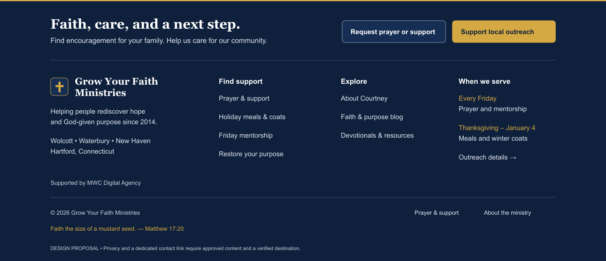

# Footer audit and proposed design

Date: November 3, 2026 (America/New_York). Source: commit `70d93ca`. Scope: the shared public footer in `src/routes/+layout.svelte`, global styles, destination routes, and relevant site configuration. The production application was not edited or deployed for this audit.

## Recommendation

Retain the navy/gold identity, cross mark, two audience pathways, semantic navigation, and visible focus styling. Replace the sponsor-led introduction and repeated promotional cards with a compact, task-oriented footer: support/outreach actions first, a short identity statement, plainly named navigation groups, an accurate schedule, and secondary sponsor attribution. Publish privacy/contact links once their actual content and destinations exist.

This is an evidence-informed design proposal, not a demonstrated conversion improvement. No audience interviews, task-completion study, or footer click analytics were available. Measurements establish current behavior; standards establish constraints; visual hierarchy and copy choices remain design judgments to validate with users.

## Measured findings

| Priority | Evidence                                                                                                                                                                                    | Consequence and proposed response                                                                                                                                                                                                                      |
| -------- | ------------------------------------------------------------------------------------------------------------------------------------------------------------------------------------------- | ------------------------------------------------------------------------------------------------------------------------------------------------------------------------------------------------------------------------------------------------------ |
| High     | At 375 CSS px, doubling the root font expands document width to 431 px. Overflowing footer elements include copyright, bottom metadata, and scripture.                                      | Fix bottom-row intrinsic sizing before visual polish. Use shrinkable children, constrained widths, and wrapping. Retest browser zoom separately; root-font enlargement is a stress test, not a complete WCAG conformance test.                         |
| High     | Footer contains no privacy or general-contact link; repository route search found no dedicated privacy/contact page. Prayer/support and resource destinations collect personal information. | Add a discoverable privacy explanation and verified contact route when approved. Existing prayer assistance is not a substitute for a general-contact channel. This finding concerns transparency and usability, not a legal-compliance determination. |
| Medium   | 216 rendered words and 16 anchors; footer height is 936 px at 1440 px, 1,160 px at 1024 px, and 2,091 px at 375 px.                                                                         | Reduce repeated founding history, sponsor copy, framed schedule cards, and long link labels. Height alone is not an accessibility failure, but the observed density is a clear opportunity to simplify scanning.                                       |
| Medium   | The leading heading describes the underwriter; the subsequent paragraph explains overhead. The same founder/year/schedule themes recur below.                                               | Lead with visitor tasks. Retain a short sponsor credit and link to details instead of making sponsorship the principal footer headline.                                                                                                                |
| Medium   | `https://marketingwithcourtney.com` redirects to `https://mwcdigitalagency.com/`; the other partner link already goes there. Both returned 200 after redirects.                             | Consolidate the two links or verify a distinct coaching destination. Differently labeled links currently lead to the same destination.                                                                                                                 |
| Medium   | Navigation links are 14.56 px; the stewardship label is 11.68 px; sponsor heading is 11.84 px. Standard links are 36 px high and CTA buttons approximately 57 px high.                      | Prefer 16 px navigation and 14 px secondary text, with 44 px interaction rows as a usability goal. The existing 36 px rows exceed WCAG's 24 px AA minimum; do not falsely label them failures. WCAG does not prescribe a universal 16 px font minimum. |
| Medium   | “52 Fridays/yr” and “40-day annual” appear in evergreen copy. Calendar calculation gives 53 Fridays and 41 inclusive outreach days in 2027; 2026 has 52 and 40.                             | Use “Every Friday” and “Thanksgiving through January 4.” Display year-specific dates only when relevant.                                                                                                                                               |
| Medium   | Geographic copy reads “Wolcott, Waterbury, New Haven & Hartford Counties,” whereas site configuration lists cities separately from New Haven/Hartford counties.                             | Use “Serving Wolcott, Waterbury, New Haven and Hartford, Connecticut.” This avoids mixing city and county categories.                                                                                                                                  |
| Review   | The footer states “100%” of outreach gifts reach the community. This audit found repeated marketing copy, not accounting evidence substantiating allocation.                                | Do not characterize the claim as independently verified. Link any retained financial claim to an approved explanation and supporting records; otherwise use factual, modest sponsor attribution.                                                       |
| Low      | XML Sitemap is the only bottom utility link.                                                                                                                                                | Keep the XML endpoint for crawlers; give visible utility space to contact/privacy once real destinations exist. A human sitemap is optional because the footer already exposes the small route set.                                                    |

## What works

- All 11 unique internal footer URLs returned HTTP 200. These were GET checks, not submission tests.
- `/prayer-and-support?tab=holiday` selected the holiday tab and displayed its panel in Chromium. Keep that direct pathway.
- Standard-size layouts at widths 320, 375, 390, 640, 768, 1024, 1280, and 1440 px had no measured horizontal overflow.
- All 16 anchors were traversed in DOM order using Tab; computed focus outlines were 2 px gold with a 3 px offset. Screen-reader and focus-obscuration conformance were not comprehensively tested.
- The public layout uses a native footer after `main` and separately named navigation regions. Admin pages intentionally bypass it.
- Sampled text/background contrast ranged from approximately 5.17:1 upward at desktop size. Samples used original computed foreground colors, alpha compositing, and background-only screenshot pixels. Container-level inherited colors were excluded where descendants override them. Sampling is not an exhaustive contrast audit of every state or every gradient position.
- Both external sponsor destinations resolved successfully. Their duplicate final destination is a labeling/information-architecture issue rather than a dead-link problem.

The temporary bottom-row CSS experiment removed all measured overflowing footer descendants. The full document still measured 431 px because other page regions also overflowed; hiding the header, announcement, and main content reduced it to 375 px. This is evidence for the footer sizing correction, not a claim that the whole page has been fixed. The experiment changed browser styles only.

## Proposed layout and copy

The illustration is a visual direction, not a responsive implementation or measured result. Its 620 px canvas includes a design-review note that is not intended for production.

1. **Compact action row.** “Faith, care, and a next step.” Supporting line: “Find encouragement for your family. Help us care for our community.” Two clear buttons: “Request prayer or support” and “Support local outreach.” Keeping outreach gold preserves the current donation emphasis; audience research should determine whether that emphasis changes.
2. **Four desktop areas.** Identity; Find support; Explore; When we serve. Plain sentence-case headings replace all-caps “Rhythm & Covenant” and “Founder & Underwriting Partners.” Remove surrounding cards and ornamental pills where a heading and a line of text suffice.
3. **Short identity.** “Helping people rediscover hope and God-given purpose since 2014.” Follow with the cities served. Mention the founding date once in the footer body.
4. **Visitor navigation.** Prayer & support → `/prayer-and-support`; Request holiday help → `/prayer-and-support?tab=holiday`; Friday mentorship → `/programs/friday-ministry`; Restore your purpose → `/restore-your-purpose`. In the illustration, “Holiday meals & coats” represents the holiday-help link; use “Request holiday help” in implementation to make the action explicit.
5. **Explore.** About Courtney → `/about`; Faith & purpose blog → `/blog`; Devotionals & resources → `/resources`. The existing brand link already supplies Home. Avoid another generic Home entry.
6. **Schedule.** “Every Friday — prayer and mentorship.” “Thanksgiving–January 4 — meals and winter coats.” “Outreach details” links to `/programs/holiday-outreach`. This distinguishes requesting assistance from learning about the program.
7. **Quieter trust and utility area.** One consolidated sponsor credit, concise copyright, and a short scripture reference. The SVG retains existing support/about links as interim utility destinations; replace this interim duplication with approved privacy/contact links when available. Do not ship dummy links, invented contact details, or unverified nonprofit/tax-deductibility badges.

### Responsive behavior

- At wide widths, fit the action row and four areas within the existing centered container. Use content fit rather than an arbitrary device model to decide where columns wrap.
- At intermediate widths, action copy sits above the buttons; the identity block spans the row; navigation becomes two columns and the schedule follows below.
- On phones, show actions first, then a short identity block and vertically stacked navigation groups. Keep links visible rather than introducing accordions for this small inventory. Buttons and link rows should be comfortably tappable; all essential content remains available.
- Use at least 44 px interaction rows as the chosen design target, 16 px navigation, and 14 px secondary copy. These are project design choices, not blanket WCAG requirements.
- Ensure all grid/flex children can shrink; apply wrapping to utility text. Retain focus indicators and respect existing reduced-motion preferences. Do not fix overflow by clipping content.
- Aim for materially less scrolling than the measured 2,091 px mobile footer. Validate after layout and typography are implemented; no mobile height reduction is claimed from the static mockup.

## Evidence and standards

- [NN/g: Footers 101](https://www.nngroup.com/articles/footers/) — research describes footer navigation, secondary tasks, and expected contact/privacy information. Supports discoverable utilities and task organization, not a promised uplift for this ministry.
- [WCAG 2.2 target size, AA](https://www.w3.org/WAI/WCAG22/Understanding/target-size-minimum.html) — 24 × 24 CSS px minimum with exceptions. Larger targets remain useful; 44 px is the proposed design goal.
- [WCAG reflow](https://www.w3.org/WAI/WCAG22/Understanding/reflow.html) — information/functionality should survive the specified narrow viewport without two-dimensional scrolling, except exempt content.
- [WCAG text contrast](https://www.w3.org/WAI/WCAG22/Understanding/contrast-minimum.html) — normal text generally needs 4.5:1; qualifying large text needs 3:1.
- [WCAG focus visible](https://www.w3.org/WAI/WCAG22/Understanding/focus-visible.html) — keyboard focus must be visible.

Sources were consulted November 3, 2026. These established sources are used because they address the measured behavior; a newer publication date is not itself evidence of better usability.

## Acceptance checks for implementation

Recheck the eight measured widths; test real 200% text resizing and 400% browser zoom; confirm no content loss, clipped focus, or horizontal footer scrolling. Exercise every destination by keyboard and touch, including browser Back after the holiday deep link. Measure all interactive states' contrast and inspect landmarks/link names with assistive technology. Validate approved privacy/contact content and sponsor destinations. Compare actual footer task success before/after rather than assuming less height means better outcomes. Do not submit live prayer requests or family details as test data.

## Evidence files and limits

`browser-evidence.json` records viewport dimensions, anchors, keyboard styles, GET status codes, and the holiday deep-link result. `additional-evidence.json` records external redirects and enlargement observations. `contrast-samples.json` records sampled ratios. `reflow-experiment.json` records the temporary CSS experiment, if complete. `current-desktop.png` and `current-mobile.png` document the current rendering; the sticky header was hidden for clean footer-only captures. `proposed-desktop.svg` is the editable design illustration.

The browser audit ran locally in Chromium against the current committed source. It is not a Safari/Firefox/device-lab test, a screen-reader certification, a financial audit, or a live production form-submission test. Application source was unchanged.
